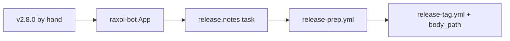

# Release cadence: weekly trains, agent-written notes

Status: proposal (2026-10-19)

## Problem

The last root release is `v2.7.0` (2026-09-09). Since then `CHANGELOG.md`
`[Unreleased]` has grown to dozens of entries (raxol_broker, chained journals,
FX, Sigstore provenance, ...) that no Hex user, and no agent reading
raxol.io/llms.txt, can see. Releasing is manual end to end: someone bumps
versions, cuts the changelog, pushes a `v*` tag, and `release.yml` attaches
GitHub's auto-generated notes (a bare PR-title list).

## Already in place

- `release.yml` -> `release-hex.yml`: tag-gated, environment-approved,
  dependency-ordered, resumable Hex train; `mix raxol.release.check` validates it.
- `release.yml` calls `llms-sync.yml` after the Hex train is verified: it
  regenerates llms.txt from the tag and opens a PR to master, so the served
  dep lines only ever name versions Hex already has.
- `Raxol.Agent.Backend.Catalog` `:openrouter` already sends attribution
  headers (`HTTP-Referer: https://raxol.io`, `X-OpenRouter-Title: Raxol`,
  `X-OpenRouter-Categories`), so every call through it counts toward Raxol on
  openrouter.ai/rankings.

## Plan

### 1. Cut the backlog (one-off)

Release `v2.8.0` from current master by hand with the existing flow, so the
train starts from an empty `[Unreleased]`.

### 2. `release-prep.yml`: weekly release PR

Scheduled weekly (and `workflow_dispatch`). Skips when nothing user-visible
merged since the last `v*` tag.

1. Diff each package in `Raxol.Release.PackageCheck.public_packages/0` against
   the last tag; a package with no changes keeps its version.
2. Bump changed packages: `### Added`/`### Changed` in its changelog section ->
   minor, only `### Fixed`/`### Security` -> patch. Dependents' `~>`
   requirements follow (the rule `mix raxol.release.check` already enforces).
3. Move `[Unreleased]` to `[X.Y.Z] - date`.
4. Generate notes (step 3) into `release-notes/vX.Y.Z.md`.
5. Open `Release vX.Y.Z` from `bot/release-vX.Y.Z`.

The release PR does NOT regenerate llms.txt: its bumped versions are not on
Hex until the tag publishes (the #1275 regression).

### 3. `mix raxol.release.notes`: notes written by a Raxol agent

A `raxol_agent` task that runs on Raxol's own backend stack, with
`--backend openrouter` given explicitly (`Backend.Resolver` does not pick a
paid backend on its own), so the generation goes through the attributed
catalog entry.

- Input: the cut changelog section plus the merged PRs since the last tag
  (`gh api`: number, title, labels, body).
- Output: a release body grouped by package, with a highlights paragraph, and
  every item linked to its PR.
- Guardrails: the task rejects output that cites a PR number not in the input
  set, or mentions a package not in the release, and fails rather than falling
  back to a template. A human reviews it in the release PR diff (AGENTS.md: no
  claims about unimplemented features).
- Model: `RAXOL_RELEASE_MODEL` (repo variable); key: `OPENROUTER_API_KEY`
  (repo secret).

### 4. Tag on merge

`release-tag.yml`: when a `bot/release-v*` PR merges, tag the merge commit
`vX.Y.Z`. `release.yml` then runs as today (Hex train behind the `release`
environment approval -> llms-sync PR + GitHub Release), but sets `body_path:
release-notes/vX.Y.Z.md` instead of `generate_release_notes: true`.

### 5. Raxol identity and co-authorship

- A GitHub App `raxol-bot` replaces `GITHUB_TOKEN` for the bot PRs (llms-sync,
  release-prep). This also fixes a current limitation: PRs opened with
  `GITHUB_TOKEN` do not trigger CI.
- Bot commits are authored by `raxol-bot`; when the notes come from the agent,
  the commit adds `Co-Authored-By: Raxol <raxol-bot app noreply address>`, and
  the PR body records the model and the OpenRouter generation id.
- Conflict: `~/CODE/CLAUDE.md` says "No Co-Authored-By lines". That rule
  targets AI-assistant trailers on human commits; it needs an explicit
  exception for `raxol-bot`'s own commits before step 5 ships.

### Order

The App comes first because steps 2 and 4 both need PRs that trigger CI.

## Open decisions

- Cadence: weekly train (proposed) or a release on every merge to master.
- Whether the post-merge `release` environment approval stays now that the PR
  is reviewed (proposed: keep it; it is the Hex publish authorization).
